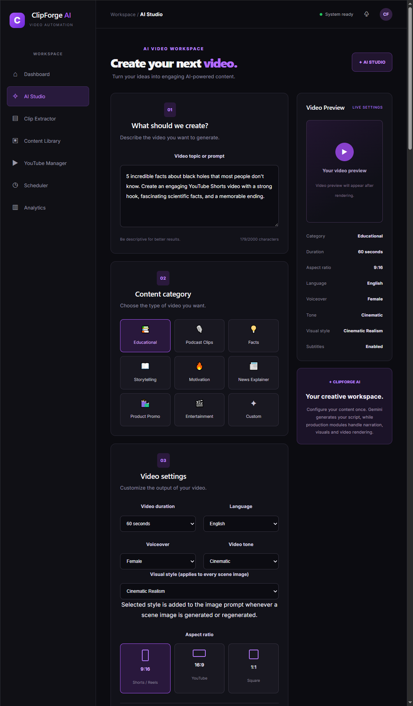
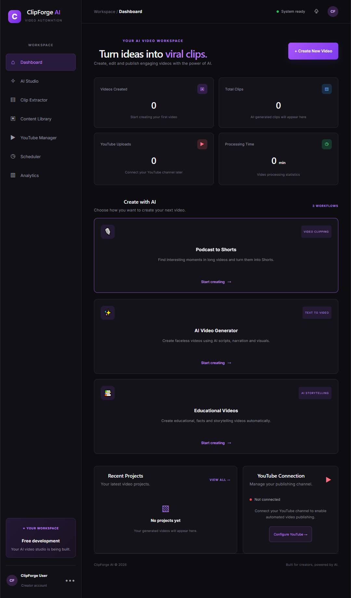
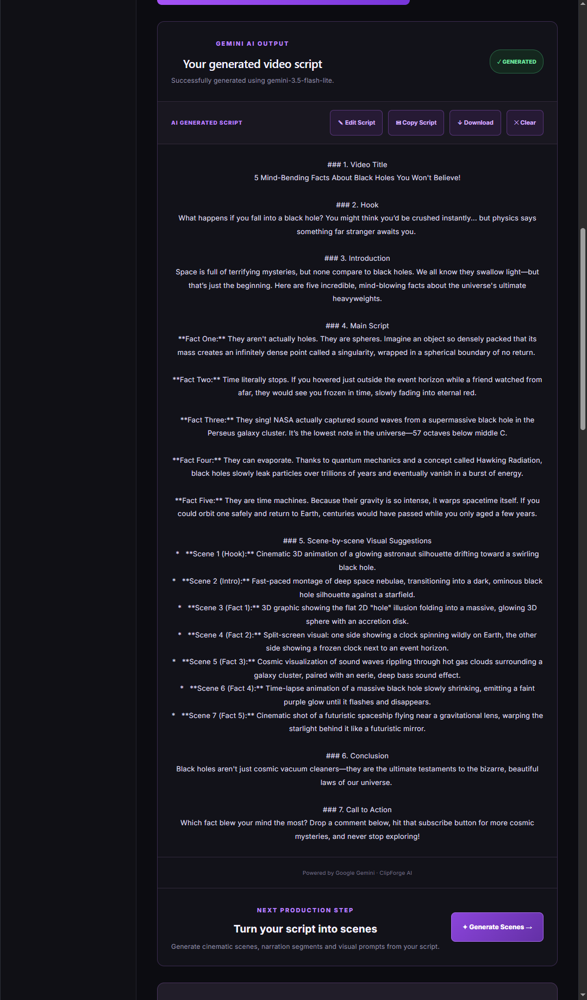
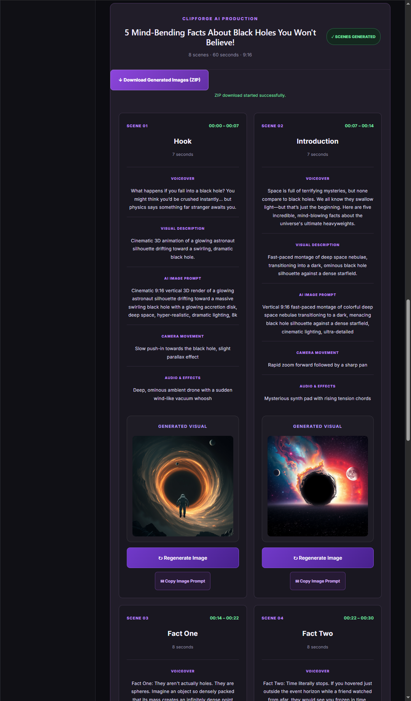

# ClipForge AI

AI-powered YouTube video production tool designed to streamline video creation through AI-generated scripts and visuals.

## Features

- AI-powered video script generation
- Automated image generation
- Cloudflare FLUX.1 Schnell integration
- ComfyUI / Stable Diffusion fallback
- React-based interactive frontend
- FastAPI backend
- AI-assisted video content workflow

## Tech Stack

### Frontend
- React
- TypeScript
- Vite

### Backend
- Python
- FastAPI

### AI Services
- Google Gemini
- Cloudflare FLUX.1 Schnell
- ComfyUI
- Stable Diffusion

## Project Structure

```text
ClipForgeAI/
├── backend/
│   ├── app/
│   │   ├── api/
│   │   ├── core/
│   │   └── services/
│   ├── workflows/
│   └── requirements.txt
└── frontend/
    ├── src/
    ├── public/
    └── package.json
```

## Setup

### Backend

1. Navigate to the backend folder:

   ```bash
   cd backend
   ```

2. Create a virtual environment:

   ```bash
   python -m venv venv
   ```

3. Activate it on Windows:

   ```bash
   venv\Scripts\activate
   ```

4. Install dependencies:

   ```bash
   pip install -r requirements.txt
   ```

5. Create a `.env` file and add your API key:

   ```env
   GEMINI_API_KEY=your_gemini_api_key_here
   ```

6. Start the backend:

   ```bash
   uvicorn app.main:app --reload
   ```

### Frontend

1. Navigate to the frontend folder:

   ```bash
   cd frontend
   ```

2. Install dependencies:

   ```bash
   npm install
   ```

3. Start the development server:

   ```bash
   npm run dev
   ```

## Screenshots

### AI Studio


### Dashboard


### Script Generation


### Scene Generation


## Status

Currently under active development.

## Author

Abhinav C